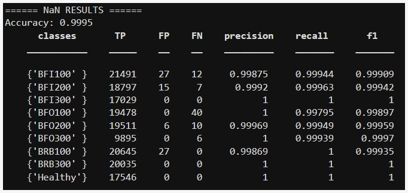
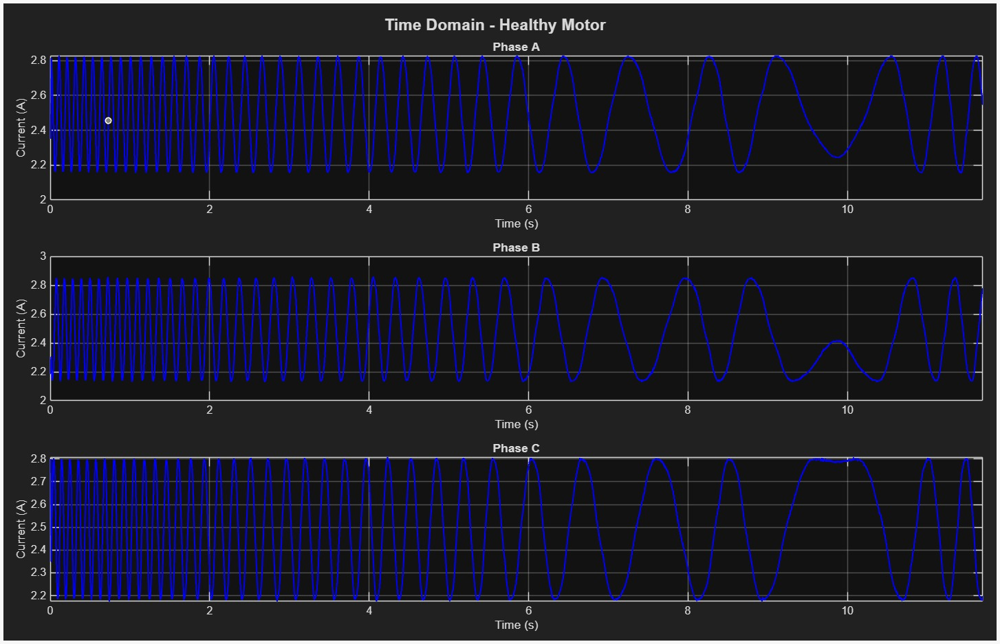
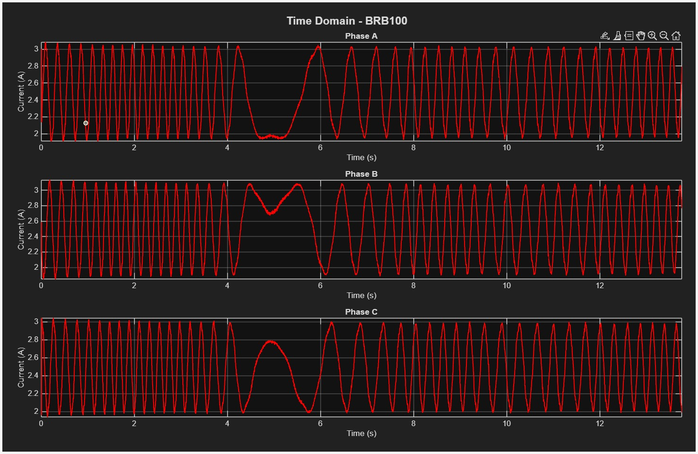
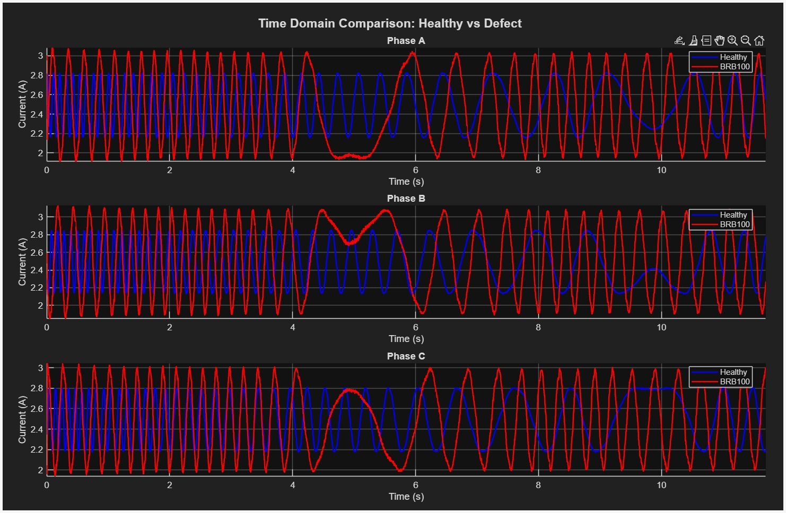
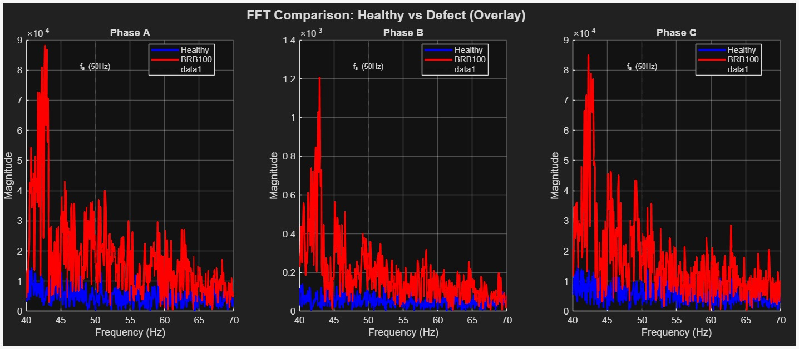
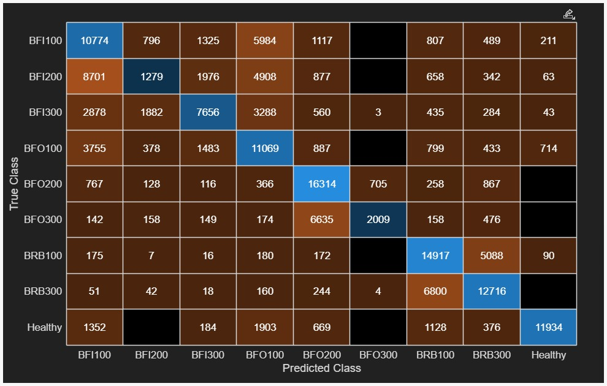

# Induction Motor Fault Detection using MCSA & Machine Learning


Non-invasive fault diagnosis of a **three-phase induction motor** from its **stator current** alone, using
**Motor Current Signature Analysis (MCSA)** and seven classical machine-learning classifiers in MATLAB.

> Semester project for **Electrical Machines (EE-260)**, Department of Electrical Engineering, SEECS, NUST.

---

## Overview

Induction motors drive most industrial processes, so an unnoticed fault can cause downtime, lost production and
safety hazards. Vibration and thermal monitoring need extra sensors mounted on the machine. MCSA uses only the motor
current, which is easy to measure: mechanical and electrical faults modulate the stator current and leave
characteristic components in its spectrum.

This project:

1. Loads 3-phase stator current recordings (Phase A, B, C) sampled at **10 kHz**
2. Visualises the signals in the **time domain** and the **frequency domain** (FFT with Hamming window)
3. Extracts spectral features around the supply frequency and the bearing fault frequencies
4. Trains and compares **7 classifiers** on **9 motor conditions**
5. Reports accuracy, precision, recall, F1 score and confusion matrices

## Fault classes

| Class | Description | Severity levels |
|---|---|---|
| `Healthy` | No fault | none |
| `BRB` | Broken Rotor Bar | 100, 300 |
| `BFI` | Bearing Fault, Inner race | 100, 200, 300 |
| `BFO` | Bearing Fault, Outer race | 100, 200, 300 |

That gives **9 classes**: `Healthy, BRB100, BRB300, BFI100, BFI200, BFI300, BFO100, BFO200, BFO300`.
A higher number means more severe damage.

## Methodology

```
Stator current (3-phase, 10 kHz)
        │
        ▼
Preprocessing ── DC removal, Hamming window, NaN → median, z-score normalisation
        │
        ▼
Spectral analysis (FFT)
   • 40–70 Hz   → supply frequency (50 Hz) and slip sidebands  (rotor bar faults)
   • 100–400 Hz → bearing characteristic frequencies           (bearing faults)
        │
        ▼
Feature extraction (14 features per phase × 3 phases = 42 features)
        │
        ▼
Classification ── 7 ML models, 70 / 15 / 15 train / validation / test split
        │
        ▼
Evaluation ── accuracy, precision, recall, F1 score, confusion matrix
```

### Frequency-domain features (per phase)

| # | Feature | What it captures |
|---|---|---|
| 1–3 | Peak, mean and 50 Hz magnitude (40–70 Hz) | Strength of the fundamental |
| 4–5 | Sideband asymmetry and total sideband power (45–55 Hz) | Broken rotor bar sidebands at *f<sub>s</sub>(1 ± 2s)* |
| 6 | Frequency of the dominant peak | Shift of the spectral peak |
| 7–8 | Total and peak power, 100–400 Hz | Overall bearing-band energy |
| 9–11 | Band power around BPFI (≈270 Hz), BPFO (≈175 Hz), BSF (≈115 Hz) | Bearing defect frequencies |
| 12 | Bearing-band power / fundamental power | Normalised fault energy |
| 13–14 | Standard deviation and kurtosis of the bearing band | Roughness and impulsiveness |

Bearing frequencies are approximated as multiples of the 50 Hz line frequency
(BPFO ≈ 3.5·f, BPFI ≈ 5.4·f, BSF ≈ 2.3·f, FTF ≈ 0.4·f).

## Results

Test-set accuracy of the seven classifiers on the 3-phase current samples:

| Model | Accuracy |
|---|---|
| **K-Nearest Neighbours (k = 5)** | **99.95 %** |
| **Random Forest (bagged, 50 trees)** | **99.95 %** |
| Quadratic Discriminant | 53.90 % |
| Decision Tree | 33.59 % |
| AdaBoost (M2) | 33.24 % |
| Naive Bayes | 29.51 % |
| Linear Discriminant | 15.15 % |

**Key findings**

- Ensemble (Random Forest) and instance-based (KNN) methods clearly outperform linear and probabilistic models,
  because the fault patterns in the current signal are strongly non-linear.
- Linear Discriminant and Naive Bayes cannot separate the different severity levels of the same fault type.
- The 40–70 Hz band around the supply frequency shows clear differences between healthy and faulty motors.

<p align="center">
  
  <br><em>Per-class precision, recall and F1 score of the best model</em>
</p>

### Visualisations

| Healthy motor (time domain) | Broken rotor bar BRB100 (time domain) |
|---|---|
|  |  |

<p align="center">
  
  <br><em>Time domain: healthy vs. BRB100 stator current</em>
</p>

<p align="center">
  
  <br><em>FFT, 40–70 Hz: the faulty motor shows much stronger components around the supply frequency</em>
</p>

<p align="center">
  
  <br><em>Confusion matrix of a weaker classifier: most errors are between severity levels of the same fault type</em>
</p>

## Repository structure

```
.
├── mcsa_fault_detection.m   # Full pipeline: loading, plots, features, training, evaluation
├── images/                  # Figures used in this README
├── LICENSE
└── README.md
```

## Getting started

### Requirements

- MATLAB R2021a or newer
- Statistics and Machine Learning Toolbox
- Signal Processing Toolbox (for `hamming`)

### Dataset

The dataset is **not included** in this repository because of its size. Download it from Mendeley Data:

> **Current Signature Dataset of Three-Phase Induction Motor under Varying Load Conditions**
> Mehran University of Engineering & Technology
> <https://data.mendeley.com/datasets/gxdd74czwh/1>

Arrange the CSV files like this, next to the script:

```
Motorfaultdataset/
├── Healthy/   *.csv
├── BRB_100/   *.csv
├── BRB_300/   *.csv
├── BFI_100/   *.csv
├── BFI_200/   *.csv
├── BFI_300/   *.csv
├── BFO_100/   *.csv
├── BFO_200/   *.csv
└── BFO_300/   *.csv
```

Each CSV holds time-series current data: rows are time steps, and the first three columns are Phase A, B and C.

### Run

```matlab
>> cd path/to/repo
>> mcsa_fault_detection
```

The script prints per-model metrics to the command window and opens figures for the time-domain signals, FFT spectra,
bearing-band analysis, confusion matrices and model comparisons. Settings such as the sampling rate, the split
ratios and the random seed are at the top of the file.

## Limitations and future work

- The 7-model comparison classifies **individual time samples** (one 3-phase current reading each), and the
  train/test split is random. Neighbouring samples from the same recording are therefore highly correlated, so the
  ~99.9 % accuracy is likely optimistic. A windowed, per-recording split would give a more realistic estimate.
- The FFT-feature classifiers currently use one recording per class. More recordings or windowed segments are
  needed for a meaningful evaluation of that branch.
- Bearing defect frequencies are approximated from the line frequency instead of being computed from the bearing
  geometry and the rotor speed.
- Possible next steps: CNN or LSTM models on raw signals, combining current with vibration data, and explainable AI
  (SHAP or LIME) to show which spectral features drive each decision.

## Team

| Name |
|---|
| Muhammad Jahan Zaib |
| Sami Haider Mirza |
| Muhammad Hussain |
| Rana Muhammad Bilal |

**Course:** Electrical Machines (EE-260) · **Instructor:** Dr. Farid Gul · **Lab Engineer:** Yasir Rizwan
Department of Electrical Engineering, SEECS, National University of Sciences & Technology (NUST), Islamabad

## References

1. *Analysis of multiple faults in induction motor using machine learning techniques.*
2. *Fault detection in induction motors based on motor current signature analysis and accelerometer.*
3. *Current Signature Dataset of Three-Phase Induction Motor under Varying Load Conditions*, Mehran University of
   Engineering & Technology. [Mendeley Data](https://data.mendeley.com/datasets/gxdd74czwh/1)

## License

This project is released under the [MIT License](LICENSE).
